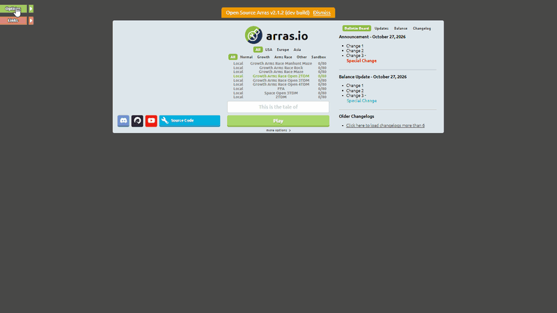
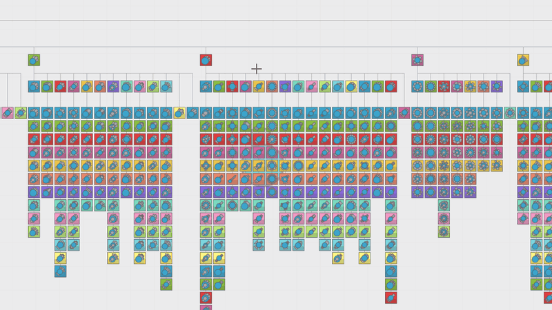
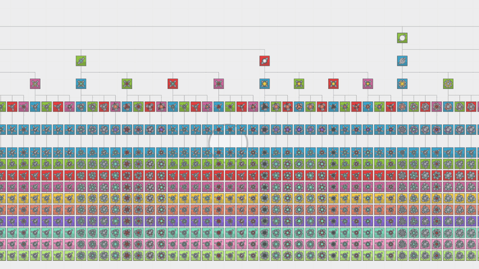
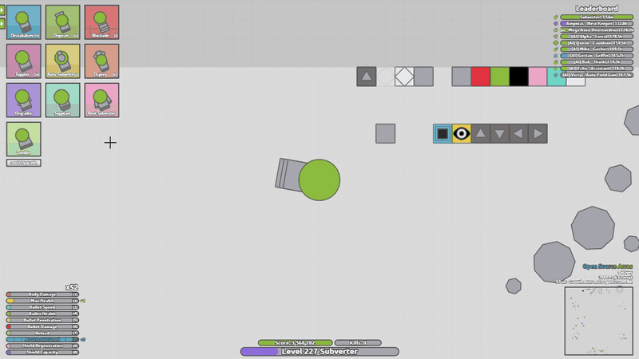

<h1 align="center">OSA iStrong Addon 2026</h1>

<p align="center">
  An addon for <a href="https://github.com/open-source-arras/open-source-arras">Open Source Arras</a> that brings it close to how arras plays in 2026.
</p>

<p align="center"></p>

## A few words from me

Hey everyone,

For months now I have been working on everything that led up to the release of this addon, and I am really happy to finally share it. It does five things:

1. **Balance.** Every entity in the game got its stats redone: tank bodies, turrets, projectiles and food shapes, all bosses and dreadnoughts included, so they play the way they do in arras 2026.
2. **Arms Race.** The full Arms Race tank pack, plus a few example Arms Race game modes to play it in.
3. **Dreadnoughts v2.** The full Dreadnoughts v2 tank pack. It replaces the old dreadnoughts with their new versions.
4. **Sandbox tools.** New sandbox options, spawning food shapes, every wall type fully working, and an in game operator menu to watch players.
5. **The 2026 look.** The old UI and in game HUD are replaced with the new 2026 design, both in game and in the main menu.

Everything is already applied on top of the newest Open Source Arras, so this folder is ready to run as it is. To see every change, scroll down to the changelog at the bottom of this page.

<p align="center"><a href="#changelog"><b>Jump to the changelog</b></a></p>

Arjuna

> [!WARNING]
> **Only the iStrong tanks have the new balance.**
>
> * You and the bots always start as iStrong tanks, so a normal game is balanced.
> * Tanks you pick from other menus, and the bosses, dominators and motherships some modes add, still use the old OSA stats. They can feel too strong or too weak.
> * To see every balanced tank, open the iStrong menu: as an admin, press <kbd>`</kbd> + <kbd>2</kbd> and click **iStrong**.

## Arms Race

The whole Arms Race tree, from the Basic to its last upgrades.

<p align="center"></p>

## Dreadnoughts v2

The new dreadnoughts, right there in the T menu.

<p align="center"></p>

## Sandbox tools

Place every wall type and spawn food shapes while you play.

<p align="center"></p>

## Run it

You need [Node.js](https://nodejs.org) 22 or newer. In this folder run:

```sh
npm install
npm run start
```

Then open `localhost:3000` in your browser. After the first install you can also start it with `run.bat` on Windows or `run.sh` on other systems.

## About

This addon is made by [Arjuna](https://github.com/Arjuna618), the creator of [iStrongEngine](https://istrong.pages.dev), an open source nonprofit tank designer and sandbox you can play in your browser.

It is built on [Open Source Arras](https://github.com/open-source-arras/open-source-arras). Their code keeps its own license (see [LICENSE](LICENSE)), and the addon itself is covered by [TERMS.md](TERMS.md): free for personal and educational use, never for profit.

This is a fan made project. It is not an official Open Source Arras release, and it is not affiliated with arras.io.

## Changelog

### Short version

* All tanks, turrets, projectiles and food shapes use the stat scale of arras.io
* Skills, levels, size and growth now work like arras.io
* Tanks drive, shoot and recoil like arras.io, and barrels kick back like arras.io
* Drones, swarms, minions, traps, blocks, boomerangs and missiles move like arras.io
* Bullets deal and take damage like arras.io against food, tanks and other bullets
* Food shapes move, bounce, drift and push each other apart like arras.io
* New shields and regeneration
* Ramming works like arras.io
* Auto turrets aim, turn and pick targets like arras.io
* New class tree (T) that looks and works like the one on arras.io
* All the tanks you can reach now load while you connect, so the class tree opens instantly
* New leaderboard, score, kill and level bars and skill upgrade menu like arras.io, and you can buy several skill points with one click
* New main page and Options, Theme and Keybinds windows like arras.io, with every arras.io theme and theme codes
* Operators get a Players window to promote, demote and kick players
* Sandbox keys like arras.io: a color wheel, a type wheel for food shapes and walls, food shapes on F and walls and rocks drawn on the grid
* All 19 wall types of arras.io, each with its arras.io look and what it does
* New Manhunt mode, the Plain and Loose mazes of arras.io and rock fields
* A tank with its own color keeps it, in every mode
* Fixed a few old bugs (auto turret range, fixedReload guns, turret leading, class tree data, food shapes that could not be pushed, dying things that blew up, see through things drawn too faint)
* Added the iStrong tanks with their own menu
* Every server starts you and the bots on the iStrong Basic, and the Arms Race servers on the iStrong Arms Race Basic
* Six example Arms Race servers: Manhunt on a mixed maze, Rock Field, Plain Maze and three open team modes
* Fixed tanks fired as projectiles living far too long, like the Conglomerate's Boosters
* run.bat opens the game in your browser once the server is up

### Full changelog

#### Stats
* Tank, turret, projectile and food shape stats now use the same scale as arras.io, so a tank does the same damage, takes the same hits and moves the same as it does there.

#### Skills
* Bullet Damage, Bullet Health and Bullet Penetration scale like arras.io. A full Bullet Damage bar is a bit over 4 times the damage, and Penetration also makes a bullet heavier and harder to stop.
* A bullet has one resistance against tanks and food and another one against other bullets.
* Penetration now raises drone damage instead of cutting drone health. Swarm drones don't lose health from it either.
* Aura rings take their owner's points.

#### Levels, size and growth
* Everyone spawns at level 45.
* Tank size at level 45 matches arras.io.
* Tanks don't get heavier past level 45 anymore, weight only follows size.
* Growth and Old Dreadnoughts grow size, health and skill points like arras.io and you keep a quarter of your score when you respawn.
* Your tank grows into a new size smoothly like on arras.io.
* How far you see grows with your size like on arras.io, so big tanks and bosses see as far as they do there.
* Size stops growing at level 1000.
* New config option growth_size_cap, the biggest radius growth can give a tank, so grown tanks still fit through maze corridors.

#### Driving
* The smasher Reload bar (Engine Acceleration) gives more push and doesn't lower your top speed anymore.

#### Firing
* Every shot pushes your tank the same no matter how fast you fire.
* A turret's recoil on its tank depends on the size of the turret.
* New gun option PUSH_ONLY for barrels that push the tank and fire nothing.
* New turret option FIRE_WITH_MASTER for turrets that fire together with your tank.
* After you change tank your first shot waits a full reload.
* Trap Speed points make traps live a bit shorter.
* Bullet Speed makes missiles launch faster and live shorter, and missile thrust doesn't grow with your skills.
* Missiles and other bullets with their own barrels get pushed by them.
* Barrels kick back with the arras.io curve. A barrel slides back and returns in 0.15 seconds and looks the same at every frame rate.

#### Auto turrets
* Auto turrets turn smoothly, settle on the target and only fire once they face it.
* They only go for what their bullets can actually reach.
* Bosses and sentinels don't lead their shots anymore, gun sentries do.

#### Projectiles
* Drones chase, rest near you and push away from each other like arras.io. How far they go to attack grows with your tank's size.
* Swarm drones steer like arras.io.
* Minions push, circle around you and keep their distance like arras.io, scaled to your size. Their shots carry most of their own speed.
* Blocks fly to where you aim, slow down and stop right there, push each other apart and let go after a while.
* Blocks and boomerangs spin with their speed and boomerangs turn back on time.
* Turrets riding on a bullet stay locked to it, aim first and then fire, and their shots don't take the bullet's speed.
* Barrels on a bullet start loaded.
* Anything a bullet makes, like minions coming out of a drone, guards around that bullet and dies with it.
* New snakeSwing controller for the Sidewinder's right click snake.
* Tanks and bullets that are always invisible fade in when something gets close to them, and can be targeted.
* The scaleWithMaster controller takes a ratio, so an aura ring can be any size against its tank.

#### Food shapes
* Food shapes glide after a push and slow down like arras.io. Nested shapes and the giant pentagons keep their speed longer.
* Tanks bounce off food shapes like arras.io. Every kind of shape has its own weight and push, and a giant pentagon throws you back.
* Bullets and other rounds push food shapes like arras.io and get pushed back by them.
* Food shapes that overlap push each other apart like arras.io.
* Food shapes drift at the pace they drift on arras.io.
* A nested shape taken by a Necromancer keeps its layers.

#### Damage against food
* Bullets hit food shapes like arras.io. Their speed and how fast they close in matter, grazing and how deep they go don't.
* Every kind of round has its own strength (bullets, missiles, traps, blocks, boomerangs, drones, swarms, minions).
* Healing bullets go through food.
* Minions deal and take damage on food like arras.io.
* Every food shape has the health, shield, damage and size it has on arras.io.

#### Damage against tanks
* Bullets hit tanks like arras.io and push them depending on what kind of round they are. Tanks knock bullets back harder.
* Tanks take less damage from bullets, except bodies that are meant to be very tough like Dominators.
* Shields are a lot smaller and Shield Capacity grows them a lot more.
* Health always comes back a little, a lot faster while the shield is full. Shield regeneration follows arras.io.
* Max Health makes a tank tougher against bullets and Body Damage makes it hit them harder.

#### Bullet against bullet
* Bullets fight each other like arras.io, with a fight resistance and a matchup for every pair of round kinds.
* Two equal bullets both die.
* Younger swarm drones win against older ones.
* New gun option FIGHT_RESIST.

#### Ramming
* A ram deals a fixed hit every tick you touch.
* Smashers hit harder in a ram and two equal tanks don't kill each other anymore.
* Food shapes and tanks ram each other like arras.io.
* Enemies bounce off each other like arras.io and teammates slide apart softly.

#### Auras and necro
* Aura rings stay on with Override, and the ring of a spawn protected tank does no damage.
* Healing fills your health first and then the shield.
* Necromancers only take plain or nested shapes with the same sides as their drones, never crashers or rare shapes.

#### Colors
* A tank whose class has its own color keeps it in every mode, it doesn't turn blue for you in Free For All.
* Changing to a tank without its own color gives you back your team color.
* Painting a tank also paints its bullets and drones that are already out.

#### Sandbox keys
* Hold the backtick and C to put a dot at your cursor. Move the mouse around the dot to pick one of 20 colors for the nearest tank, food shape or wall, like arras.io. A press alone gives it the last color you picked.
* Hold the backtick and Z on a food shape to change it along six arms around the dot: size, type and rarity, one step every 120 units. The shape changes in place, keeps its drift and spin and grows or shrinks smoothly into its new size.
* Z on a wall picks one of the 19 wall types around the dot, and the last slice turns it into a rock. Z on a rock turns it into a wall the same way.
* The backtick and F spawn the last shape you picked with Z, on every press and while you hold it.
* The backtick and X draw a wall on a grid of 60 units from the corner of the map. Hold X and move diagonally to grow it a whole cell at a time, X on a wall or a rock removes it.
* With the rock picked in the Z menu, X makes a rock at your cursor that grows to reach it while you hold X.
* Things that get moved without speed, like a growing wall or a dragged shape, glide smoothly from tick to tick.
* Letting go of the backtick ends every key you were holding.
* Team and Invite to team keep a tank's own color.

#### Walls
* Every wall type of arras.io works like it does there.
* Deadly walls take 60% of your max health on each touch, shield first, and throw you off. Base walls do the same to anyone not on their team and let their own team through.
* Healing walls give 60% of your max health on each touch and the rest goes into your shield.
* Bouncy walls throw tanks and food shapes off and bounce bullets back.
* Breaker walls make whatever touches them bigger and hold bullets without killing them. Chunks walls make whatever touches them smaller.
* Optical walls let a tank that touches them see 2.5 times farther.
* One Way walls let tanks and food shapes in from behind their arrow, carry them through the way the arrow points, and are solid from every other side.
* Sticky walls pull tanks in and hold them. You slide along them and get flung off the corners, and bullets get stuck in them.
* Trick walls let everything through and turn see through when you come close.
* Paint walls give their color to whatever touches them and hold bullets without killing them.
* Filter walls only let tanks and food shapes of their own color through.
* Team walls put a tank that touches them on the wall's team.
* Portal walls pull you in and send you out of another Portal wall of the same color.
* Checkpoint walls let you through and set your respawn point.
* Every wall type has the colors, parts and see through amount of arras.io, like the gray arrow on One Way walls and the inner squares of Portal and Checkpoint walls.
* Walls placed with X fill their grid cell exactly.

#### Game modes
* New Manhunt mode. A kill gives you your victim's whole score, the top player turns green and always has enough skill points to max every skill, and levels go up to a million.
* New maze types 21 (Plain Maze) and 24 (Loose Maze) from arras.io.
* New modes maze_plain (a Plain Maze) and maze_mixed (a Plain or a Loose Maze, half and half), on a map 7680 wide.
* New config option maze_pool to pick the maze type from a list.
* New config option rock_field to lay rocks on a pattern of tiles, the count, kinds and sizes of arras.io, and a rock_field mode with the Rock FFA map, 7260 wide with about 510 rocks.
* New room room_open, 16 by 16 open tiles.
* Six example servers with Growth and Arms Race: Manhunt on a mixed maze, Rock Field, Plain Maze and three open team modes.
* Every server starts you and the bots on the iStrong Basic, so every tank you or a bot upgrades into comes from the iStrong pack. Arms Race servers start on the iStrong Arms Race Basic.
* The Healer is hidden on the Arms Race servers, as in arras. You can still reach it from the Arms Race Basic in the iStrong Tanks menu.

#### Class tree
* Rebuilt the T menu. Same layout, zoom, search and look as arras.io, and it's drawn with WebGL so it stays fast with thousands of tanks.
* Tanks in the tree are drawn the same way they are in game, with arras.io outlines.
* Every menu opens its own tree and a tank picked from a menu opens that menu's tree, so you always see everything you can reach from where you are.
* Huge trees show each branch once so they open instantly.
* New tank option PASS_UPGRADE_COLOR so a menu's color carries on to the tanks under it.
* New tank option UPGRADE_LEVEL, the level all of a tank's upgrades open at. The tier still sets where they sit in the tree.
* The tree closes when you die.
* Every tank you can reach from your spawn tank and your token's tank is loaded while the game says Connecting, like arras.io does it, so T opens instantly.
* The main menu already downloads those tanks for the server you picked and your browser keeps them, so joining again only checks if anything changed.
* The server prepares the tank data once in the background and sends it as one compressed pack instead of thousands of small messages for every player.
* Tank data is almost a third smaller. A turret inside a tank now only carries where it sits and its color, the rest was already sent with the turret itself.
* A tank you switch to that isn't in your pack still gets its tree sent in small packs in the background.
* Sending tank data doesn't slow down anymore the more tanks you've already received.
* New config option mockup_send_budget, how many milliseconds a tick the server can spend preparing and sending tank data while people are playing.

#### HUD
* The leaderboard looks and moves like arras.io. Rows slide in and out from the right, climb and drop smoothly, scores count up instead of jumping, and a player who leaves keeps his row for a moment while it slides away.
* Leaderboard scores are shortened like arras.io (1.23k, 4.50m) and a long name gets cut with "..." so the text stays inside its bar.
* The score, kill and level bars have the sizes, places and colors of arras.io. The level bar is purple.
* The kill bar shows how much of your score came from kills, and the text only shows assists and boss kills once you have some.
* Your name above the bars is drawn like on arras.io.
* The skill menu looks like arras.io's and every bar is as long as its maximum level.
* Hovering a skill bar shows the levels you would get and one click buys all of them, no more clicking over and over.
* The skill menu slides away when you have no points left and comes back when you move the mouse into the bottom left corner.
* A maxed stat shows its name in its own color.
* The minimap background and tiles use the arras.io colors.

#### Menus
* The main page looks like arras.io's. It's bigger, the bulletin tabs switch instantly and the Discord, YouTube and source code buttons got the arras.io size and look.
* The dev build notice above the main page moves with it.
* The server list is spread like on arras.io: the region on the left, the mode in the middle and the players on the right.
* Options and Links tabs on the top left like arras.io. They slide in when the page opens and their windows slide out from them.
* The Options window has the Options, Theme and Keybinds tabs of arras.io with the same look, tooltips, dropdowns and motion.
* The color picker is the one from arras.io. It slides in under the color you click, or above it when there's no room below, so it's always on screen.
* Turning on Secret Options adds the Secrets tab of arras.io with its options. Full Secret Options adds Show Localhost, which now works without reloading the page.
* In game the tabs shrink to an arrow on the left and slide out when you hover them. They're always there like on arras.io.
* Every arras.io theme is in with its exact colors, Light and Dark included. Dark, Classic, Natural, Lyric, Solarized Dark and Gruvbox were a bit off and now match arras.io.
* Theme codes work like on arras.io. Copy the code to share your theme or paste one to load it. You can change every color, the border blend and neon borders, and save your own themes or remove them.
* Change a keybind by clicking its key in the Keybinds tab.
* OSA's own settings, the token box and the addons moved to the "more options" link under Play, in a window with the new look. If another window is open it fades into OSA's settings.
* The Auto Reconnect and Chat Messages options now work.
* Removed the Uncapped Height option because the main page now has the fixed arras.io size.
* Removed the Ingame Options option because the in game tabs are always shown like on arras.io.
* Arena Supervisors and Operators get a second arrow that opens the Players window. It lists real players only and you can promote, demote or kick anyone below your rank.
* Added a link to the iStrong Tank & Game Mode Maker in Resources.

#### Starting the server
* run.bat opens the game in your browser by itself once every server is up, on the port the web server really listens on. Starting it with npm start or run.sh opens nothing, so hosted servers stay the same.

#### Bug fixes
* A tank fired as a projectile, like the Conglomerate's Boosters, never ran out of range and lived until newer ones replaced it. It now lives as long as its gun's range allows, shortened by Bullet Speed like a bullet.
* Auto turrets and healers never used their bullets' range, the check looped over a Map.
* Guns marked fixedReload never kept their fire rate.
* AI.NO_LEAD was never read.
* Turrets led their shots with their tank's speed instead of their bullet's.
* The class tree showed upgrades of the parent class even when a class had RESET_UPGRADE_MENU.
* Most food shapes could not be pushed at all and overlapping ones never pushed each other apart, their pushability came out as 0.
* A wall or a shape that died while it was still changing size kept stretching and got huge while it faded out.
* A tank that left a class with its own color kept that color.
* Anything see through was drawn much fainter than it should be, its opacity got applied twice.

#### iStrong tanks
* Added an iStrong menu to the Special Menu with every iStrong tank and boss, all the dreadnoughts and the Arms Race tree, sorted into the same pages as in iStrong.
* Added pages for the iStrong food shapes and map objects.
* The addon shows up as iStrong Patch 2026 in the addons list.
* Every iStrong tank opens its own tree on T and its tiles use the iStrong colors.
* Every iStrong tank looks like it does in iStrong, with all its body layers, turrets, marks, aura rings and its own projectiles.
* Body layers that take the tank's color in iStrong follow its color when it changes.
* A tank whose widest body layer is solid, like the Celestials, touches and weighs with that layer, like in iStrong.
* Decorative turrets never shoot and auto turret bases have their own shape and color.
* Every Arms Race tier and every other upgrade opens at level 45 like in iStrong.
* The Others look like in iStrong with all their parts, the see through walls are see through and the Eye has the size of the eyes on iStrong's walls.
